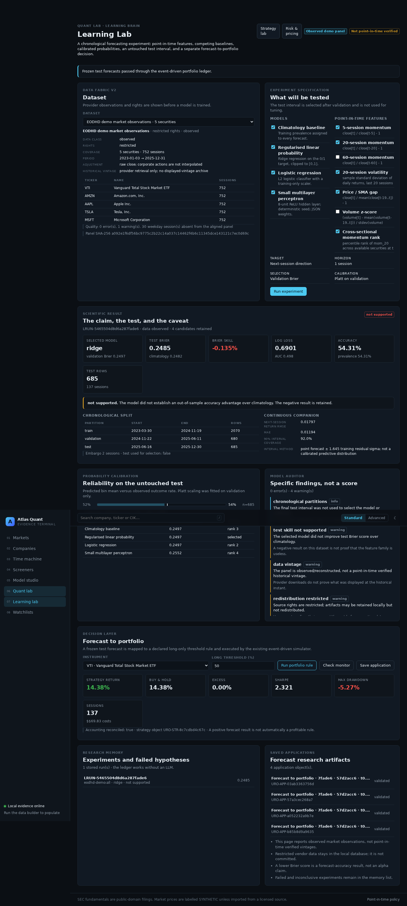
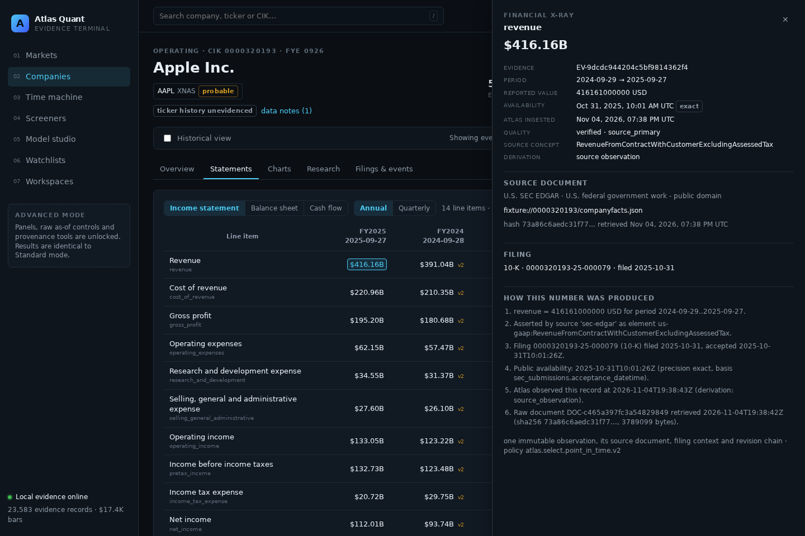

# Atlas Quant — Phase 6

**A local-first financial research terminal, quantitative research lab and scientific
learning system built on a point-in-time evidence platform.**

Phase 1 built the trustworthy layer: immutable evidence, exact availability, stable
security identity, adjustment mathematics and a reverse dependency index. Phase 2 added the
terminal. Phase 3 added the compiled financial model runtime, Model Forge, DCF and research
applications. Phase 4 added Quant Lab: point-in-time features, versioned strategies,
next-open backtests, an independently reconciled ledger, IBM real-data experiments and
Time Capsules. Phase 5 added institutional fixed income, options, portfolio risk,
optimization and walk-forward validation. **Phase 6 adds the Atlas Learning Brain:** a real
data fabric, point-in-time features, trained and calibrated forecasting, chronological
scientific experiments, an independent model auditor, persistent research memory, bounded
discovery, monitoring and a complete forecast-to-portfolio application. See
[docs/PHASE6_IMPLEMENTATION.md](docs/PHASE6_IMPLEMENTATION.md).

```
Terminal demo: 5 issuers · 8 securities · 14,977 filings · 23,583 evidence records
Phase 6 learning demo: 5 real vendor histories · 3,760 bars · 752 sessions · schema v8
363 backend tests · 4 frontend tests · Phase 6 browser journey
Real SEC fundamentals · official public 2024 U.S. Treasury curve
Phase 6 prices REAL vendor demo observations, restricted local research only
Not point-in-time verified · five current names, not a market universe
Independent Brier/log-loss/ECE tests · negative real-data result retained
```



---

## 1. What works

### Phase 1 foundation (consumed, not rebuilt)

| Capability | Command |
|---|---|
| SEC filings + XBRL facts, recent and archive history | `atlas sec sync --cik 320193` |
| Point-in-time reconstruction, two time semantics | `atlas asof --cik 320193 --date 2024-06-01` |
| Provenance / Financial X-Ray | `atlas explain --evidence-id EV-…` |
| Entity, security, listing and ticker history | `atlas entity show --ticker FB --as-of 2021-06-01` |
| Immutable bars, splits, dividends, adjustment views | `atlas bars show … --adjustment total_return` |
| Validation, independent reconciliation, dependency index | `atlas validate`, `atlas reconcile`, `atlas deps` |

### Phase 2 terminal

| Capability | Where | Notes |
|---|---|---|
| Coverage overview | `/` | every stored security, last close, source, SYNTHETIC badge |
| Company search and profiles | `/companies` | name, ticker or CIK; ambiguous tickers are a hard stop |
| Financial statements | company → Statements | FY/quarterly, point-in-time, 14+ line items, every cell opens X-Ray |
| Metrics | company → Overview | formula, inputs, assumptions, evidence ids; missing inputs reported |
| Charts | company → Charts | candles/line/area, volume, raw / split / total-return index, action markers |
| Indicators | company → Charts | 9 server-computed, versioned indicators with formula table |
| Filings and events | company → Filings | SEC history and corporate actions; no synthetic headlines |
| Financial X-Ray | any value | value → source element → accession → document hash → narrative |
| Time machine | `/research` | reconstruct statements and metrics at a chosen instant |
| Screener | `/screeners` | 26 metrics, AND/OR, deterministic, CSV export, explicit universe |
| Watchlists | `/watchlists` | stable security ids, persisted in SQLite |
| Workspaces | `/workspaces` (Advanced) | validated JSON documents, 3 presets, resize/reorder/save/restore |
| HTTP API + OpenAPI | `/api/*` | typed validation, error envelope, pagination, source metadata |

### Phase 4 Quant Lab

| Capability | Where | Notes |
|---|---|---|
| Point-in-time features | `/lab`, `/api/quant/features` | price, return, SMA, momentum, volatility, volume z-score; cutoff enforced |
| Strategy objects | `/api/quant/strategies` | `atlas.strategy.v1` in the research-object registry |
| Event-driven backtests | `/lab`, `/api/quant/backtest` | close decision, next-open fill, costs, splits, dividends |
| Independent accounting | Lab reconciliation panel | cash/trade/commission/dividend/realized/unrealized identity |
| Buy-and-hold benchmark | every run | same bars and costs |
| Model Forge signal | Lab custom strategy | shared compiler and operator registry |
| Vectorized preview | `/api/quant/preview` | close-to-close triage, explicitly not a fill simulation |
| Experiments and Time Capsule | Lab history/capsule | save, reopen, fork, compare, replay, export |
| Source archives | `/api/research/archive` | SHA-256 bytes plus rights/retention metadata |

### Phase 5 institutional research

| Capability | Where | Notes |
|---|---|---|
| Multi-instrument panel | `/api/institutional/universe` | 935 aligned returns, 3 active synthetic names, 1 documented delisting |
| Treasury curve | `/api/institutional/curve` | official 2024 CSV, semiannual par bootstrap, exact SHA-256 |
| Bond analytics | `/api/institutional/bond` | clean/dirty price, accrued, YTM, durations, convexity, DV01, shocks |
| Option analytics | `/api/institutional/option` | BSM price/Greeks, parity, implied volatility |
| Portfolio risk | `/api/institutional/portfolio` | covariance, beta, VaR/ES, drawdown, contributions, sectors, stress |
| Optimization | `/api/institutional/optimize` | long-only, cap, cash, target return; explicit infeasibility |
| Walk-forward | `/api/institutional/validate` | rolling/expanding, embargo, frozen test, 24/36-attempt logs |
| Compiler operators | `/api/models/operators` | discount, bond, option, variance, volatility and risk contributions |
| Research applications | `/lab/institutional` | fixed income, portfolio risk, OOS validation, save/reopen/fork/export |

### Phase 6 Learning Brain

| Capability | Where | Notes |
|---|---|---|
| Real market panel | `/lab/learning`, `/api/learning/dataset` | 5 EODHD demo histories, 3,760 bars, 752 sessions, restricted local cache |
| Dataset quality and rights | Learning Lab dataset card | observed class, restricted rights, 0 errors / 1 warning, explicit vintage limitation |
| Point-in-time features | `/api/learning/catalog` | price/volume/cross-sectional features; `date < target_date` enforced |
| Competing models | Learning Lab | climatology, ridge, logistic, 8-unit MLP; JSON artifacts, no pickle |
| Chronological experiment | `/api/learning/experiment` | 60/20/20 split, 2-session embargo, frozen test, retained attempts |
| Calibration lab | Learning Lab | Platt on validation; Brier, log loss, AUC, 10-bin reliability table |
| Model auditor | `/api/learning/runs/{id}/audit` | named findings with evidence and limitations; no aggregate score |
| Research memory | `/api/learning/memory` | runs, attempts, models and forecasts; works without an LLM |
| Bounded discovery | `/api/learning/discovery` | finite grid, budget cap, final test never used, recommendations only |
| Monitoring | `/api/learning/runs/{id}/monitor` | feature drift and realized calibration; no automatic retrain/deploy |
| Forecast-to-portfolio | Learning Lab decision layer | frozen `learning_probability` signal through the existing event-driven ledger |

The real demonstration, `LRUN-5465504d8d6a287fade6`, selects ridge and then reports test
Brier **0.248493**, Brier skill **-0.001354**, AUC **0.497647**, and conclusion
**`not_supported`**. The auditor returns **0 errors / 4 warnings / 2 infos**. The frozen 0.50
threshold rule returns **14.3797%**, exactly buy-and-hold; 0.55 holds cash. Forecast accuracy
and strategy value are reported separately. These are not alpha claims.

Reference bond (4.25% 2029, 2024-06-28 curve): clean **99.634862**, YTM **4.3294%**,
modified duration **4.461737**, DV01 **0.045422** per 100 face. BSM reference
(`S=K=100, T=1, r=5%, σ=20%`): call **10.450584**, put **5.573526**, parity residual below
`1e-12`. The 3-fold synthetic walk-forward returns **-4.18%** versus **2.33%** for equal
weight (189 test sessions); with 36 attempts, adjusted p is **1.0**. Negative results are
retained. Benchmarks and limits: [docs/PHASE5_BENCHMARKS.md](docs/PHASE5_BENCHMARKS.md).

Real IBM demonstration, 2,977 sessions (2015-01-02 → 2026-11-03), $100,000,
2 bps commission + 5 bps slippage: buy-and-hold **108.60%**, 20/100 trend **-39.49%**,
60-session momentum **16.12%**, Model Forge signal **24.17%**. Every ledger reconciled.
These are in-sample research results, not alpha claims. Full measurements:
[docs/PHASE4_BENCHMARKS.md](docs/PHASE4_BENCHMARKS.md).

### Phase 2.1 hardening and research

| Capability | Where | Notes |
|---|---|---|
| Real IBM market data | company → Charts | 6,793 Alpha Vantage bars, 114 actions, `reported`, archived with SHA-256 provenance |
| Independent validation | company → Research | recomputes margins, ratios, valuations, split adjustment and total return; IBM **233/233** |
| Financial history | company → Research | annual, evidence-linked, no interpolation |
| Peer comparison | company → Research | local universe only, medians over reporting issuers |
| Restatements / amendments | company → Research | superseded values retained and addressable |
| Research objects | `/api/research/objects` | v1 contracts for dataset/model/experiment/strategy/application; no execution |

Performance on the demo database: company list **1,341 ms → 48 ms cold / 9 ms cached**;
screener **3,285 ms → 1,604 ms**. See [docs/PHASE2_1_READINESS.md](docs/PHASE2_1_READINESS.md).

---

## 2. Quickstart

```bash
python3 -m venv .venv
.venv/bin/pip install -e ".[dev,terminal,learning]"

# Build the terminal demo: real SEC fixtures + deterministic synthetic OHLCV
.venv/bin/python scripts/build_terminal_db.py --db var/atlas.db --force

# Build the Phase 6 learning demo from the local EODHD demo cache
.venv/bin/python scripts/build_phase6_db.py --db var/atlas-phase6.db --force --offline

# Build the terminal UI once (FastAPI serves web/dist)
cd web && npm ci && npm run build && cd ..

# Serve API + UI on loopback
.venv/bin/atlas --db var/atlas-phase6.db serve --host 127.0.0.1 --port 8000
# open http://127.0.0.1:8000/lab/learning
```

The vendor cache is intentionally not committed. A clean checkout without it has no real
panel; the Learning Lab reports that rather than substituting synthetic securities.

Development UI with hot reload: `cd web && npm run dev` (Vite proxies `/api` to
`127.0.0.1:8000`). `make terminal-data`, `make web-build` and `make serve` wrap the same
steps. No network access is needed after the fixtures are present.

---

## 3. Two modes, one backend

**Standard** is the guided interface: overview, statements, charts, time machine, screener
and watchlists. **Advanced** adds the workspace editor, raw as-of controls and indicator
parameter inputs. Both call the same endpoints; switching modes re-renders and does not
change a single value. The browser journey captures statement text in both modes and
asserts they are identical.


---

## 4. Data honesty

* Fundamentals are real, public-domain SEC EDGAR data archived in `fixtures/sec`.
* **IBM market prices are real vendor observations** from the Alpha Vantage demo source,
  registered as `reported`, with retrieval provenance and 114 corporate actions. They are
  raw observations, not proof of the vendor's 2015 display vintage; the Time Capsule reports
  `external_provider_only` because exact source bytes are not archived.
* **Phase 6 uses a separate real vendor demo panel** (AAPL, MSFT, TSLA, VTI, AMZN) with
  3,760 observed bars. It is registered `restricted`, cached only under `var/`, and never
  committed. The window starts after the sample's last split; dividends are excluded.
* **The Phase 6 panel is not point-in-time verified.** It is a current vendor download,
  not an archive of what was displayed historically. The API returns
  `point_in_time_verified: false`; the auditor emits a `data_vintage` warning.
* **Other market prices are synthetic.** Apple, Microsoft, Walmart and Alphabet series are
  generated deterministically, registered as source `synthetic-demo` (kind `synthetic`),
  marked `data_status: "synthetic"` by the API, badged in every table and chart, and
  announced by a page-level banner. They are never described as exchange data.
* Apple's real 4:1 split (2020-08-28) and cash dividends are stored so raw, split-adjusted
  and total-return views can be verified against hand calculations.
* **Total return is an index (base 1.0), not a price.** Every response says so.
* **No currency conversion.** Ratios use same-currency inputs only; the dataset is USD.
* **Missing is not zero.** A missing statement input is `null` with `missing: true` and a
  visible dash; a metric that cannot be computed is listed in `missing`.
* **Screening covers the stored universe** (4 issuers) and says so explicitly; it is not a
  market-wide screen.
* **Point-in-time means point-in-time.** `as_of=2023-12-31` on Apple returns FY2023 and
  earlier, counts records that existed but were not yet public, and never leaks later
  restatements.



---

## 5. Non-negotiable guarantees

1. Evidence is immutable; restatements add records and preserve history.
2. No invented availability: unevidenced timing is excluded and counted, never assumed.
3. No ticker identity: tickers are time-bounded attributes of listings.
4. No float money and no silent unit mixing.
5. Adjusted series are never adjusted twice; a total-return index is never called a price.
6. Derived values state their rule and inputs; read-time ratios state their formula.
7. Ingestion is idempotent and transactional; restart safety is tested.
8. Filing coverage is reported; an unfetched archive is a counted gap.
9. Reconciliation re-derives facts with independent code.
10. Dependencies are indexed, not inferred.

---

## 6. Measured performance

`benchmarks/terminal_bench.py` against `atlas serve` on `var/atlas.db` (41.2 MB), 7 samples
per endpoint, Python 3.12.3, SQLite WAL. Server RSS **87.2 MB**; cold first read
(open DB + company page + statements) **1,817 ms**.

| Endpoint | Median | p95 |
|---|---|---|
| `GET /api/companies` | 1,341 ms | 1,396 ms |
| `GET /api/companies/{id}` | 205 ms | 209 ms |
| `GET /api/companies/{id}/statements` | 206 ms | 222 ms |
| `GET /api/companies/{id}/metrics` | 563 ms | 587 ms |
| `GET /api/securities/{id}/market` (1Y) | 28 ms | 30 ms |
| `POST …/market` (total return + 4 indicators) | 35 ms | 36 ms |
| `GET /api/evidence/{id}` | 2.6 ms | 2.8 ms |
| `POST /api/screeners/run` | 3,285 ms | 3,303 ms |
| `GET /api/companies/{id}/filings?limit=50` | 6.5 ms | 6.9 ms |

The company list and screener are recomputation-bound, not I/O-bound; a market-wide
universe would need caching or a materialised panel. No optimisation is claimed. Full runs
and caveats: [docs/BENCHMARKS.md](docs/BENCHMARKS.md).

---

## 7. Verification

```bash
.venv/bin/python -m pytest -q          # 363 passed (354 through Phase 5 + 9 Phase 6)
cd web && npm test -- --run            # 4 passed
cd web && npm run build                # tsc + vite
```

Browser journeys (`web/e2e/journeys.mjs`) cover the legacy terminal journeys;
`web/e2e/studio.mjs` covers 11 Phase 3 checks; `web/e2e/phase4.mjs` covers historical
reopen, buy-and-hold/trend/custom-model runs, accounting, Time Capsule replay, comparison,
JSON export and a 390px mobile viewport. `web/e2e/phase5.mjs` covers the Treasury curve,
bond pricing, saved fixed-income application, manifest download, portfolio risk,
optimization, walk-forward, comparison and a 390px viewport. `web/e2e/phase6.mjs` covers
the real-data experiment, calibration, audit, forecast-to-portfolio, monitoring,
save/reopen and a 390px viewport. Screenshots are in `artifacts/`.

---

## 8. Repository layout

```
src/atlas/
  core/        ids, units, temporal semantics, concept registry, typed errors
  storage/     SQLite engine, versioned migrations (schema v8), source registry
  evidence/    temporal evidence kernel, selection, provenance
  entities/    issuer / security / listing / ticker master and resolution
  market/      calendars, immutable bars, corporate actions, adjustments
  ingestion/   SEC client + parsers, CSV/Parquet import
  terminal/    read models, indicators, screener, user stores, workspaces, FastAPI app
  quant/       features, strategy contracts, portfolio ledger, simulator, Quant Lab
  finance/     Treasury curves, bond analytics, BSM options, statistical primitives
  institutional/ multi-asset fixture, risk, optimizer, walk-forward, persistence
  learning/    data fabric, features, models, metrics, audit, experiments, memory, discovery
  research/    research objects and content-addressed source archives
  cli.py       command line interface (incl. `serve`)
tests/         363 tests (Phase 1–6 plus terminal API/workspaces)
web/           React 19 + TypeScript + Vite terminal; Vitest and Playwright journeys
benchmarks/    Phase 1 benchmarks + terminal_bench.py
fixtures/      real SEC payloads and labelled synthetic fixtures
artifacts/     measured performance JSON and browser screenshots
docs/          architecture, ADRs, contracts, implementation record, benchmarks
```

Dependency rule: `core` depends on nothing; `terminal` may depend on everything below it,
never the reverse. The kernel does not know HTTP exists.

---

## 9. Known limitations

* IBM prices are real vendor demo observations; the other four issuers are synthetic. Phase
  6 adds five separate real vendor demo histories. No licensed feed or survivorship-free
  universe is present.
* Phase 5's multi-asset panel is **synthetic**, with one delisted path. It is not a real
  market universe and is not survivorship-bias-free.
* Phase 6's five real demo names are selected by current availability, cover 2023–2025, and
  are not point-in-time verified. They cannot support a market-wide or persistent-alpha
  claim.
* Quant Lab supports one real instrument, long-only, raw daily bars and next-open fills. It
  does not model shorting, partial fills, market impact, intraday auctions or an order book.
* Phase 5 pricing remains pure Python. Phase 6 installs NumPy 2.5.4, SciPy 1.18.1,
  scikit-learn 1.9.1 and PyArrow 26.0.1 for learning only. Bonds are hypothetical, options
  are model values, and the optimizer handles at most eight assets with no turnover or
  sector caps.
* Phase 6 implements binary and continuous forecasts, not categorical probabilities or
  event-market settlement. It does not provide a live feed, scheduler, GPU backend, AI
  assistant, or multi-user authentication.
* `ATLAS_MASTER_SPEC.md` v1.1 is absent from the checkout; `docs/PHASE5_CONTRACT.md` and the
  Phase 5 documents are the in-repo authority until the supplied master is added.
* No news, transcripts, estimates or analyst data; events are filings and actions only.
* Screening covers 4 issuers, not a market.
* X-Ray is reachable from statement cells, metrics and workspace evidence panels; chart
  bars are not individually clickable because bars are not evidence records.
* Workspace editing uses explicit buttons, not drag-and-drop.
* Single-user, no authentication. `owner_id = 'local'`; the server binds loopback by
  default and must not be exposed publicly.
* Frontend bundle ~630 kB (189 kB gzip); the chart library could be lazy-loaded.
* Browser verification in this container needs a workspace-local Chromium sysroot
  (`scripts/fetch_browser_libs.py`); that is test tooling, not a runtime dependency.

---

## 10. Documentation

| Document | Contents |
|---|---|
| [docs/ARCHITECTURE.md](docs/ARCHITECTURE.md) | module contracts, schema, ingest/selection algorithms |
| [docs/PHASE4_IMPLEMENTATION.md](docs/PHASE4_IMPLEMENTATION.md) | what Phase 4 built, real-data results, verification and limits |
| [docs/PHASE5_IMPLEMENTATION.md](docs/PHASE5_IMPLEMENTATION.md) | Phase 5 subsystems, schema 7, verification and boundaries |
| [docs/MULTI_INSTRUMENT_RESEARCH.md](docs/MULTI_INSTRUMENT_RESEARCH.md) | synthetic universe, alignment and portfolio semantics |
| [docs/HISTORICAL_UNIVERSE_INTEGRITY.md](docs/HISTORICAL_UNIVERSE_INTEGRITY.md) | membership, delisting and survivorship limits |
| [docs/WALK_FORWARD_VALIDATION.md](docs/WALK_FORWARD_VALIDATION.md) | partitions, selection protocol and attempt ledger |
| [docs/INSTITUTIONAL_PRICING_ARCHITECTURE.md](docs/INSTITUTIONAL_PRICING_ARCHITECTURE.md) | dependency audit and adapter boundary |
| [docs/YIELD_CURVE_CONTRACT.md](docs/YIELD_CURVE_CONTRACT.md) | Treasury source, bootstrap and conventions |
| [docs/BOND_PRICING_VALIDATION.md](docs/BOND_PRICING_VALIDATION.md) | bond formulas, reference values and tolerances |
| [docs/DERIVATIVES_PRICING.md](docs/DERIVATIVES_PRICING.md) | BSM model, conventions and limitations |
| [docs/PORTFOLIO_RISK.md](docs/PORTFOLIO_RISK.md) | covariance, VaR/ES, contributions and stress |
| [docs/PORTFOLIO_OPTIMIZATION.md](docs/PORTFOLIO_OPTIMIZATION.md) | constraints, solver and diagnostics |
| [docs/PHASE5_BENCHMARKS.md](docs/PHASE5_BENCHMARKS.md) | measured cold/warm research workloads |
| [docs/PHASE5_READINESS.md](docs/PHASE5_READINESS.md) | acceptance gates and unsupported scope |
| [docs/PHASE6_IMPLEMENTATION.md](docs/PHASE6_IMPLEMENTATION.md) | Phase 6 subsystems, schema 8, real result and defects |
| [docs/FINANCIAL_DATA_FABRIC_V2.md](docs/FINANCIAL_DATA_FABRIC_V2.md) | dataset view, timing and quality checks |
| [docs/MARKET_DATA_RIGHTS.md](docs/MARKET_DATA_RIGHTS.md) | provider rights and local-only data handling |
| [docs/HISTORICAL_AVAILABILITY.md](docs/HISTORICAL_AVAILABILITY.md) | evidence classes and point-in-time limits |
| [docs/FEATURE_ENGINE_V2.md](docs/FEATURE_ENGINE_V2.md) | features, windows and leakage defenses |
| [docs/LEARNING_RUNTIME.md](docs/LEARNING_RUNTIME.md) | models, JSON artifacts and dependencies |
| [docs/FORECAST_OBJECT_CONTRACT.md](docs/FORECAST_OBJECT_CONTRACT.md) | binary/continuous forecast and decision boundary |
| [docs/PROBABILITY_CALIBRATION.md](docs/PROBABILITY_CALIBRATION.md) | scoring identities, calibration and results |
| [docs/ML_EXPERIMENT_VALIDATION.md](docs/ML_EXPERIMENT_VALIDATION.md) | chronological protocol and negative result |
| [docs/MODEL_AUDITOR.md](docs/MODEL_AUDITOR.md) | findings, evidence and no aggregate score |
| [docs/RESEARCH_MEMORY.md](docs/RESEARCH_MEMORY.md) | persistent experiment ledger without an LLM |
| [docs/AUTOMATED_DISCOVERY.md](docs/AUTOMATED_DISCOVERY.md) | bounded candidate search and limits |
| [docs/PHASE6_BENCHMARKS.md](docs/PHASE6_BENCHMARKS.md) | measured CPU pipeline |
| [docs/PHASE6_READINESS.md](docs/PHASE6_READINESS.md) | acceptance matrix and partial gate 5 |
| [docs/PHASE6_CONTRACT.md](docs/PHASE6_CONTRACT.md) | Phase 5 → Phase 6 interfaces |
| [docs/PHASE7_CONTRACT.md](docs/PHASE7_CONTRACT.md) | stable interfaces and next-phase prerequisites |
| [docs/QUANT_LAB_ARCHITECTURE.md](docs/QUANT_LAB_ARCHITECTURE.md) | Quant Lab modules, event ordering and boundaries |
| [docs/STRATEGY_CONTRACT.md](docs/STRATEGY_CONTRACT.md) | strategy schema, supported signals and rejection rules |
| [docs/FEATURE_ENGINE.md](docs/FEATURE_ENGINE.md) | features, cutoffs and anti-leakage behavior |
| [docs/PORTFOLIO_ACCOUNTING.md](docs/PORTFOLIO_ACCOUNTING.md) | ledger identities, costs, splits, dividends |
| [docs/PHASE4_VALIDATION.md](docs/PHASE4_VALIDATION.md) | acceptance matrix and test evidence |
| [docs/PHASE2_IMPLEMENTATION.md](docs/PHASE2_IMPLEMENTATION.md) | what Phase 2 built, verification ledger, measurements, defects fixed |
| [docs/PHASE3_CONTRACT.md](docs/PHASE3_CONTRACT.md) | stable API/JSON contracts and extension points for Phase 3 |
| [docs/PHASE2_CONTRACT.md](docs/PHASE2_CONTRACT.md) | Phase 1 → Phase 2 read/write interfaces |
| [docs/TERMINAL_CONTRACT.md](docs/TERMINAL_CONTRACT.md) | original read-model specification |
| [docs/CONCEPTS.md](docs/CONCEPTS.md) | canonical concept coverage and mapping policy |
| [docs/BENCHMARKS.md](docs/BENCHMARKS.md) | hardware, datasets, Phase 1 and Phase 2 measurements |
| [docs/VALIDATION.md](docs/VALIDATION.md) | reconciliation methodology and results |
| [docs/adr/](docs/adr/) | architecture decision records (29) |

Licence: Apache-2.0. Fixtures retain the licensing of their sources; see
[fixtures/README.md](fixtures/README.md).
