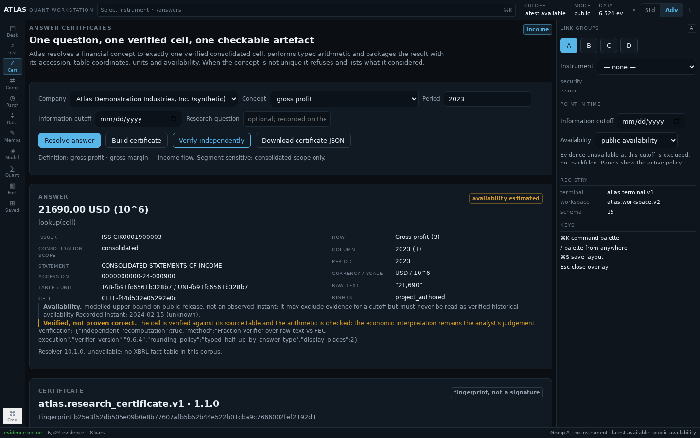
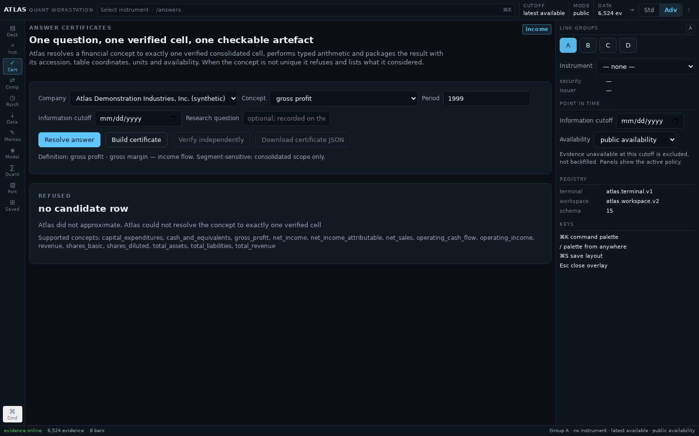
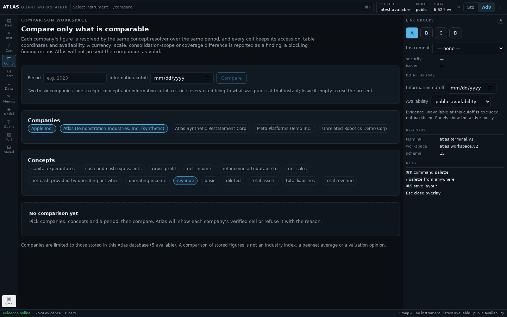
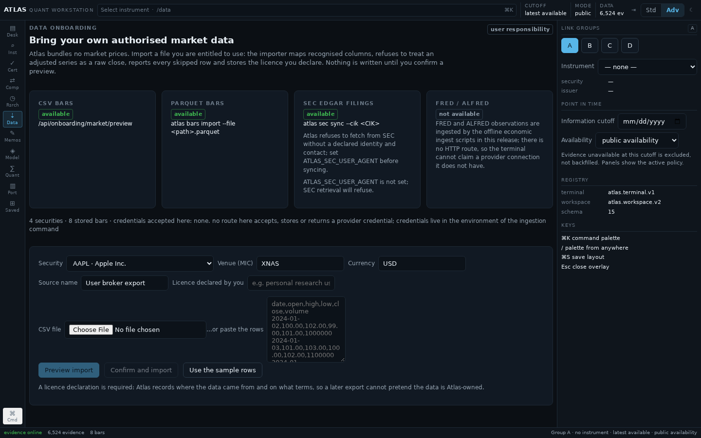

# Atlas

**The Evidence-First Financial Research Operating System.**

Atlas connects a financial question to the exact
source cell or passage that answers it, to the computation that produced the number, and to an
independent check of that computation — or it refuses with a reason you can act on.

Most financial tools give you a number. Atlas gives you a number you can challenge.

> Release: **v0.2.0-beta.2** (`0.2.0b2`), Apache-2.0, an experimental public preview and a
> prerelease. This is a research system, not an investment product. It does not claim institutional
> trading performance, terminal parity with commercial vendors, or hallucination-free answers, and no
> independent human evaluation has been performed. Read
> [known limitations](docs/KNOWN_LIMITATIONS.md) before using it for anything that matters.

[](LICENSE)
[](pyproject.toml)
[](docs/KNOWN_LIMITATIONS.md)

## Why Atlas exists

A printed financial figure is not an answer. The same label appears in consolidated and segment
statements, in original and amended filings, in thousands or millions, at different dates, and with
different meanings ("net income" versus "net income attributable to the parent"). Revision, scope and
timing silently change the number.

Atlas treats those as first-class problems:

- **Statement identity and scope.** Every fact carries issuer, statement family, period, unit, scale,
  and consolidated-versus-segment scope. Ambiguity is refused, not guessed.
- **Availability, not just date.** A filing's SEC acceptance instant is not its public-release
  instant. Where availability is modelled rather than observed, Atlas says so and labels the value as
  a bound.
- **Closed-vocabulary concepts.** A row label must match a concept's every word; "Total revenues"
  does not become "operating revenue" and a segment total does not become a consolidated total.
- **Independent arithmetic.** Accepted computations are recomputed by a separate exact-fraction
  verifier, and evidence certificates are re-checked against pinned bytes.
- **Typed refusals.** Abstention is a result with a code, an explanation and the evidence that was
  considered — including the cases where the correct answer is "this cannot be distinguished".

Verification status is reported honestly. A certificate proves internal consistency and source
identity; it does **not** prove an interpretation is economically correct. Atlas keeps that
distinction in the result itself (`verified_but_not_proven_correct`).

## What works today

Verified in this release (see [release readiness](docs/RELEASE_READINESS.md) for the gate-by-gate
evidence):

| Capability | State |
|---|---|
| Offline demonstration from a packaged wheel (`atlas demo`) | Working, no network, no credentials |
| Local terminal API + bundled web UI (`atlas serve`) | Working, loopback-only by default |
| Database lifecycle: `init`, `migrate`, `doctor`, backup/restore helpers | Working |
| SEC EDGAR ingestion (submissions, company facts, filing documents) | Working; needs a `User-Agent` and network |
| Point-in-time retrieval (`facts --as-of`, `asof`, historical mode) | Working, with explicit availability semantics |
| Evidence certificates and `verify-certificate` | Working; four verification levels |
| Financial-Economic Compiler with an independent verifier | Working |
| Declarative application packages (`.atlas`), export/import/replay | Working; no executable package code |
| Financial answer resolution with typed abstentions | Working; measured results below |
| Price-movement investigation with publication-time integrity | Working; synthetic and user-imported price data |
| Banking/institutional models, economic scenario models, decision certificates | Working, each with stated eligibility and limits |
| Research memos | Export as Markdown, HTML, JSON and a paginated PDF |
| External MCP interface | **Working**: local stdio server, 14 tools, read-only by default |
| Answer certificates | Working: resolve, cite, export, verify independently |
| Command palette | Working: ten entity classes over the live database |
| Cross-company comparison | Working: 2–6 companies, one period, evidence per cell, blocking findings for incompatible currency/scale/scope |
| Market-data onboarding | Working for CSV; licence declared and recorded per import |

## Screenshots

Captured from the released build on Chromium at 1440×900; the same pages at 390×844 are in
[`docs/launch/screenshots/`](docs/launch/screenshots/).

| Answers with evidence | Refusal with a reason |
| --- | --- |
|  |  |

| Cross-company comparison | Market-data onboarding |
| --- | --- |
|  |  |

## Release status and launch materials

- **Published.** v0.2.0-beta.2 is a GitHub prerelease and the package is published on PyPI as
  `atlas-quant` `0.2.0b2`. All eleven engineering gates and the licensing and data-rights gates pass
  on the exact artifacts (Apache-2.0 applied, licence metadata inside the wheel, zero restricted
  vendor material in any artifact). Verdict: **PUBLIC RELEASE PUBLISHED — PRERELEASE, EXPERIMENTAL**
  — see [`docs/RELEASE_GATES.json`](docs/RELEASE_GATES.json),
  [`docs/RELEASE_READINESS.md`](docs/RELEASE_READINESS.md) and the runbook in
  [`docs/PUBLIC_RELEASE_HANDOVER.md`](docs/PUBLIC_RELEASE_HANDOVER.md).
- **Install guide:** [`docs/QUICKSTART.md`](docs/QUICKSTART.md) · **verify a release**:
  [`docs/RELEASE_VERIFICATION.md`](docs/RELEASE_VERIFICATION.md) · **landing page** (static, no
  server, published through GitHub Pages by `.github/workflows/pages.yml`):
  [`docs/launch/index.html`](docs/launch/index.html) · **architecture**:
  [`docs/launch/ARCHITECTURE.svg`](docs/launch/ARCHITECTURE.svg) · **compatibility**:
  [`docs/PLATFORM_MATRIX.md`](docs/PLATFORM_MATRIX.md).
- **Verified against real data:** Apple's FY2026 10-K (45/45 acceptance steps, every citation
  carrying the period it prints), official `mcp` SDK interoperability, and a 21-step browser
  certification of the certificate flow that passes on Chromium locally and on Chromium, Firefox
  and WebKit in hosted CI.
- **Contributing:** [`CONTRIBUTING.md`](CONTRIBUTING.md). **Beta evaluations:**
  [`docs/launch/BETA_PROGRAM.md`](docs/launch/BETA_PROGRAM.md).

## Install and run in five minutes

Requires Python 3.12+. No Node, no database server, no paid data provider, no API key.

```bash
python -m venv .venv
. .venv/bin/activate            # Windows: .venv\Scripts\activate
pip install "atlas-quant[terminal]==0.2.0b2"

atlas --db var/atlas.db init          # create and migrate the database
atlas --db var/atlas.db doctor        # schema, integrity and foreign-key checks
atlas demo --db-path var/demo.db      # offline end-to-end demonstration
atlas serve --db-path var/atlas.db --port 8000
```

`--db` is a global option and must come **before** the subcommand (`atlas --db PATH init`);
`atlas init --db PATH` is rejected. `demo` and `serve` also accept `--db-path`, which overrides the
global value. To install from the release assets instead of PyPI, download the wheel and
`SHA256SUMS` from the release page and verify them first
(`sha256sum -c SHA256SUMS`; macOS: `shasum -a 256 -c SHA256SUMS`), then
`pip install "atlas_quant-0.2.0b2-py3-none-any.whl[terminal]"`.

Then open <http://127.0.0.1:8000>. The wheel bundles the built terminal and the small demonstration
fixture set, so nothing else has to be installed. The API binds to loopback and refuses a
non-loopback bind unless you explicitly acknowledge it; it has no authentication and must not be
exposed to a network.

From a source checkout, use `make install`, then `make demo`, `make focus-demo`, `make test`.

## A first research workflow

```bash
# 1. Ingest a registrant's filings (network; requires an SEC-compliant user agent)
export ATLAS_SEC_USER_AGENT='YourApp/1.0 you@example.com'
atlas sec sync --cik 0000320193

# 2. Ask for a fact as of a point in time
atlas facts --cik 0000320193 --concept revenue --as-of 2026-11-01 --json

# 3. Explain how a stored fact was selected
atlas entity show --cik 0000320193

# 4. Verify a certificate against pinned bytes
atlas verify-certificate --manifest artifacts/focus_source_manifest.json \
  --snapshots var/focus/snapshots --strict <certificate.json>
```

The offline FOCUS demonstration pins a manifest over archived SEC bytes and replays thirteen real
filing cases, then applies 29 self-consistent retampered certificates and expects every one to be
rejected. It exits non-zero if a tamper is accepted or an expected refusal is missing:

```bash
make focus-corpus      # network: archive 4 filings
make focus-manifest    # explicit trust anchor
make focus-demo        # offline: cases, certificates, mutations, refusals
```

Thirteen cases across Coca-Cola, JPMorgan and 3M: **10 answered, 3 refused**, each for a different
reason (one unanswerable from the available statement, one historical-availability refusal, one
known resolver gap). A refusal that happens to be correct is never counted as an answered question.

## What the evidence looks like

Every accepted answer carries: concept definition, issuer, statement family, period, as-of instant,
accession number, exact cell or span, scale and currency, the computation, its operands, the
independent verification result, limitations, conflicting evidence and any refusal reason. The same
structure is available as JSON (`/api/...` endpoints and exported research objects), so a third party
can re-verify an answer without trusting the interface that produced it.

## Measured research results

These are development results on frozen corpora, reported with the caveat that they are not an
independent human evaluation:

| Corpus | Baseline resolver | Geometry-aware resolver | False confident answers |
|---|---|---|---|
| Development corpus (22 questions) | 20/22 fully correct | 22/22 fully correct | 0 in both arms |
| Post-holdout development cohort (47 questions) | 36/47 | 41/47 | 0 in both arms |

The 47-question cohort was used for a first scoring run and is therefore **post-holdout development**,
not a fresh independent holdout. Original gold labels and the first-run results are frozen and
byte-verified; corrections are recorded as append-only adjudications with a sensitivity table, never
by editing the historical record. See [the hardening report](docs/FINANCIAL_ANSWER_HARDENING.md) and
[the holdout report](docs/ANSWER_SEMANTICS_HOLDOUT_REPORT.md).

## Data, rights and security

- Atlas ships **synthetic market fixtures** and derived public-source financial facts. It does not
  ship licensed market data. Every committed data class has a stated rights basis in the
  [source-rights inventory](docs/DATA_RIGHTS_INVENTORY.json) and is re-checked by
  `scripts/audit_distribution.py`.
- The **development repository's earlier history** still contains nine Nasdaq and Alpha Vantage
  series that were removed from the tree. They are absent from this release, from the wheel, the
  sdist and the sanitized source snapshot, and from the single-commit public distribution candidate.
  Restricting that development repository does not recall copies already downloaded, and this README
  does not claim it does. See [data rights](docs/DATA_RIGHTS_AUDIT.md) and
  [repository migration](docs/REPOSITORY_MIGRATION.md).
- The local service is unauthenticated by design. It binds to loopback, rejects foreign `Host`
  headers (DNS rebinding) and refuses cross-origin writes. See [SECURITY.md](SECURITY.md).
- Retrieved documents are untrusted content. Atlas never executes package code, never runs arbitrary
  SQL from a request and never treats retrieved text as instructions.

## Repository map

```text
src/atlas/core          identifiers, units, temporal semantics, concepts
src/atlas/storage       SQLite schema, migrations, backup and integrity
src/atlas/evidence      temporal evidence kernel, point-in-time selection
src/atlas/ingestion     SEC EDGAR and market-data adapters
src/atlas/research      answer resolution, filings, price intelligence, memos
src/atlas/fec           Financial-Economic Compiler and independent verifier
src/atlas/applications  declarative package SDK and runtime
src/atlas/finance       valuation, banking, fixed income, derivatives
src/atlas/institutional risk, validation, portfolio models
src/atlas/decision      convex decision certificates and revision impact
src/atlas/terminal      local HTTP API and static terminal hosting
web                     React terminal (built assets are bundled into the wheel)
scripts                 ingestion, evaluation, audit and release tooling
docs                    user, research, rights, security and release documentation
```

## Documentation

Start with [QUICKSTART.md](QUICKSTART.md). Then:

- [User guide](docs/USER_GUIDE.md) · [Troubleshooting](docs/TROUBLESHOOTING.md) · [Known limitations](docs/KNOWN_LIMITATIONS.md)
- [Architecture](docs/ARCHITECTURE.md) · [Financial answer hardening](docs/FINANCIAL_ANSWER_HARDENING.md) · [Research intelligence](docs/RESEARCH_INTELLIGENCE.md)
- [Data rights audit](docs/DATA_RIGHTS_AUDIT.md) · [Source-rights inventory](docs/DATA_RIGHTS_INVENTORY.json) · [Security model](docs/APPLICATION_SECURITY_MODEL.md)
- [Release readiness](docs/RELEASE_READINESS.md) · [Release gates](docs/RELEASE_GATES.json) · [Release notes](RELEASE_NOTES.md)
- [Cohort v2 evaluation protocol](docs/ANSWER_SEMANTICS_COHORT_V2_PROTOCOL.md) · [Engineering history](docs/FINANCIAL_ANSWER_HARDENING.md)

## Contributing, licence and citation

Contributions are welcome; read [CONTRIBUTING.md](CONTRIBUTING.md) and [SECURITY.md](SECURITY.md)
first.

Atlas-authored software is licensed under the **Apache License, Version 2.0** —
`Copyright 2026 Satwik Peddireddi`. See [LICENSE](LICENSE), [NOTICE](NOTICE) and
[third-party notices](THIRD_PARTY_NOTICES.md); the decision and ownership verification are recorded
in [licensing](docs/LICENSING.md) and
[the authorization record](licenses/AUTHORIZATION-RECORD.md). The licence covers Atlas's code,
documentation and project-authored synthetic fixtures only. **Data rights are separate and
inventoried per source**; no third-party dataset is relicensed, and no licensed vendor market data
ships in any artifact. Citation metadata is in [CITATION.cff](CITATION.cff).

External MCP clients: see [MCP_GUIDE.md](docs/MCP_GUIDE.md). Beta feedback: see
[the beta program](docs/launch/BETA_PROGRAM.md) and the issue templates in `.github/ISSUE_TEMPLATE/`.
