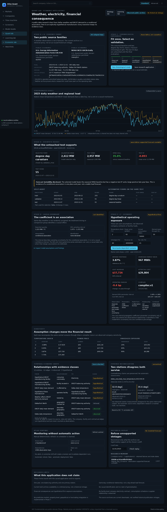
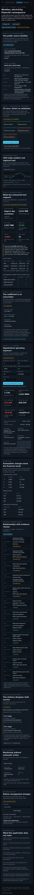
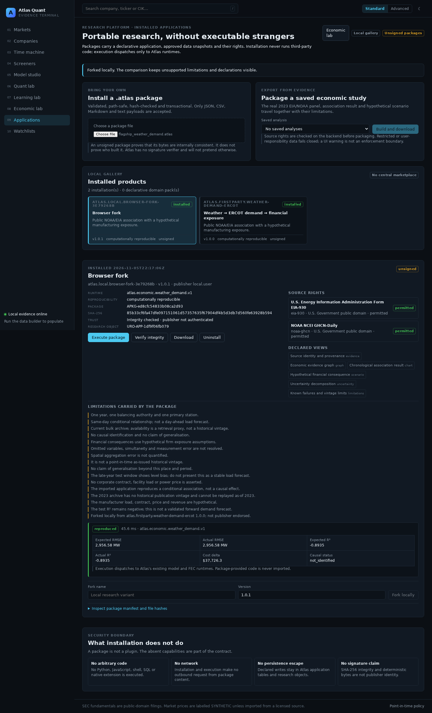
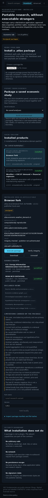

# Atlas Quant — Phase 9

**A local-first financial research terminal, quantitative research lab and scientific
learning system built on a point-in-time evidence platform.**

Phase 1 built the trustworthy layer: immutable evidence, exact availability, stable
security identity, adjustment mathematics and a reverse dependency index. Phase 2 added the
terminal. Phase 3 added the compiled financial model runtime, Model Forge, DCF and research
applications. Phase 4 added Quant Lab: point-in-time features, versioned strategies,
next-open backtests, an independently reconciled ledger, IBM real-data experiments and
Time Capsules. Phase 5 added institutional fixed income, options, portfolio risk,
optimization and walk-forward validation. Phase 6 added the Atlas Learning Brain: a real
data fabric, point-in-time features, calibrated forecasting and an audited
forecast-to-portfolio experiment. **Phase 7 adds economic intelligence:** real public EIA
and NOAA observations, a source-backed economic graph, a claim/conflict ontology,
association-aware causal research, an uncertainty-bearing scenario simulator, FEC-backed
financial consequences, manual Sentinel invalidation and a complete Economic Lab. See
[docs/PHASE7_IMPLEMENTATION.md](docs/PHASE7_IMPLEMENTATION.md) and
[docs/WEATHER_ENERGY_CASE_STUDY.md](docs/WEATHER_ENERGY_CASE_STUDY.md).

**Phase 8 adds portable research applications:** a deterministic, declarative
`atlas.application_package.v1` format; an install/execute/fork/export/uninstall lifecycle;
a local gallery; an SDK and CLI; a real declarative domain pack; backend-enforced data
rights; migration backup and rollback checks; and a pinned package containing the real 2023
EIA/NOAA Economic Lab. Untrusted package code is never executed and signatures are explicitly
unsupported. See [docs/APPLICATION_PACKAGE_SPEC.md](docs/APPLICATION_PACKAGE_SPEC.md),
[docs/PHASE8_IMPLEMENTATION.md](docs/PHASE8_IMPLEMENTATION.md) and
[docs/PHASE8_ACCEPTANCE.md](docs/PHASE8_ACCEPTANCE.md).

**Phase 9 adds integrated, source-grounded equity research:** a deterministic report over
real SEC facts, a point-in-time workspace, an independent DCF component audit, an explicit
financial-institution refusal, a coverage-versus-valuation readiness split and a portable
research application that reproduces its numbers from a clean database. The 20-company
fixture has 16 issuers with valid financial coverage and 17 whose DCF executes and passes
the arithmetic audit; three financial institutions are refused rather than valued with an
inadmissible model. See [docs/PHASE9_IMPLEMENTATION.md](docs/PHASE9_IMPLEMENTATION.md),
[docs/PHASE9_FINANCIAL_RECONCILIATION.md](docs/PHASE9_FINANCIAL_RECONCILIATION.md) and
[docs/PHASE9_READINESS.md](docs/PHASE9_READINESS.md).

The supplied `ATLAS_MASTER_SPEC.md` v1.2.0 is still **not present** in the checkout. This
is documented as a blocker; no substitute file was invented. The Phase 9.2 common-equity
gate is closed, but master-spec conformance and Phase 9 completion are not claimed.

**Phase 9.2 corrects the bank starting book:** SEC `StockholdersEquity` minus same-period
SEC preferred stock, both GAAP basis. JPM opens at **$324.708B** common equity (not
$344.758B total equity); GS opens at **$108.743B**. Phase 9.2.1 moves ROE to average common
equity (JPM **18.1925%**, ending-equity proxy 17.5136%) and removes free `growth`. The
corrected reference value is **$295.4644/share** for JPM at the default 10% cost of equity;
the explicit 17% ROE / 9.5% CoE case remains **$287.9196**. Regulatory stress is
**GAAP equity/assets**, not Tier 1 leverage. See
[PHASE9_2_FINAL_ACCEPTANCE.md](PHASE9_2_FINAL_ACCEPTANCE.md) and
[docs/PHASE9_2_1_INTEGRITY_AUDIT.md](docs/PHASE9_2_1_INTEGRITY_AUDIT.md).

```
Terminal demo: 5 issuers · 8 securities · 14,977 filings · 23,583 evidence records
Phase 6 learning demo: 5 real vendor histories · 3,760 bars · 752 sessions · schema v9
Phase 7 economic demo: 365 public days · 1,095 observations · 12 evidence edges
Phase 8 package: 47,270 bytes · 6 declarative files · deterministic · unsigned
Phase 9 real universe: 20 issuers · 489 filings · 26,440 evidence records
Phase 9 readiness: 16 valid financial coverage · 17 DCF executions · 3 institutions refused · 4 restricted prices
Phase 9 bank valuation: JPM common book $324.708B · average common ROE 18.1925% · default $295.4644
Phase 9.2.1 integrity: append-only multi-source bars · 29/29 independent checks · package $295.4644 reproduced
Public-domain EIA-930 and NOAA GHCN · two Dallas stations · spatial representativeness
Observed weather is not a forecast · current archive is not a historical vintage
Association, not causation · test R² −0.8935 retained · hypothetical firm exposure
Independent Brier/log-loss/ECE tests · Phase 6 negative market result retained
Schema 13 · Applications at /applications · FR Y-9C evidence · local gallery
```





---

## 1. What works

### Phase 1 foundation (consumed, not rebuilt)

| Capability | Command |
|---|---|
| SEC filings + XBRL facts, recent and archive history | `atlas sec sync --cik 320193` |
| Point-in-time reconstruction, two time semantics | `atlas asof --cik 320193 --date 2024-06-01` |
| Provenance / Financial X-Ray | `atlas explain --evidence-id EV-…` |
| Entity, security, listing and ticker history | `atlas entity show --ticker FB --as-of 2021-06-01` |
| Immutable bars, splits, dividends, adjustment views | `atlas bars show … --adjustment total_return` |
| Validation, independent reconciliation, dependency index | `atlas validate`, `atlas reconcile`, `atlas deps` |

### Phase 2 terminal

| Capability | Where | Notes |
|---|---|---|
| Coverage overview | `/` | every stored security, last close, source, SYNTHETIC badge |
| Company search and profiles | `/companies` | name, ticker or CIK; ambiguous tickers are a hard stop |
| Financial statements | company → Statements | FY/quarterly, point-in-time, 14+ line items, every cell opens X-Ray |
| Metrics | company → Overview | formula, inputs, assumptions, evidence ids; missing inputs reported |
| Charts | company → Charts | candles/line/area, volume, raw / split / total-return index, action markers |
| Indicators | company → Charts | 9 server-computed, versioned indicators with formula table |
| Filings and events | company → Filings | SEC history and corporate actions; no synthetic headlines |
| Financial X-Ray | any value | value → source element → accession → document hash → narrative |
| Time machine | `/research` | reconstruct statements and metrics at a chosen instant |
| Screener | `/screeners` | 26 metrics, AND/OR, deterministic, CSV export, explicit universe |
| Watchlists | `/watchlists` | stable security ids, persisted in SQLite |
| Workspaces | `/workspaces` (Advanced) | validated JSON documents, 3 presets, resize/reorder/save/restore |
| HTTP API + OpenAPI | `/api/*` | typed validation, error envelope, pagination, source metadata |

### Phase 4 Quant Lab

| Capability | Where | Notes |
|---|---|---|
| Point-in-time features | `/lab`, `/api/quant/features` | price, return, SMA, momentum, volatility, volume z-score; cutoff enforced |
| Strategy objects | `/api/quant/strategies` | `atlas.strategy.v1` in the research-object registry |
| Event-driven backtests | `/lab`, `/api/quant/backtest` | close decision, next-open fill, costs, splits, dividends |
| Independent accounting | Lab reconciliation panel | cash/trade/commission/dividend/realized/unrealized identity |
| Buy-and-hold benchmark | every run | same bars and costs |
| Model Forge signal | Lab custom strategy | shared compiler and operator registry |
| Vectorized preview | `/api/quant/preview` | close-to-close triage, explicitly not a fill simulation |
| Experiments and Time Capsule | Lab history/capsule | save, reopen, fork, compare, replay, export |
| Source archives | `/api/research/archive` | SHA-256 bytes plus rights/retention metadata |

### Phase 5 institutional research

| Capability | Where | Notes |
|---|---|---|
| Multi-instrument panel | `/api/institutional/universe` | 935 aligned returns, 3 active synthetic names, 1 documented delisting |
| Treasury curve | `/api/institutional/curve` | official 2024 CSV, semiannual par bootstrap, exact SHA-256 |
| Bond analytics | `/api/institutional/bond` | clean/dirty price, accrued, YTM, durations, convexity, DV01, shocks |
| Option analytics | `/api/institutional/option` | BSM price/Greeks, parity, implied volatility |
| Portfolio risk | `/api/institutional/portfolio` | covariance, beta, VaR/ES, drawdown, contributions, sectors, stress |
| Optimization | `/api/institutional/optimize` | long-only, cap, cash, target return; explicit infeasibility |
| Walk-forward | `/api/institutional/validate` | rolling/expanding, embargo, frozen test, 24/36-attempt logs |
| Compiler operators | `/api/models/operators` | discount, bond, option, variance, volatility and risk contributions |
| Research applications | `/lab/institutional` | fixed income, portfolio risk, OOS validation, save/reopen/fork/export |

### Phase 6 Learning Brain

| Capability | Where | Notes |
|---|---|---|
| Real market panel | `/lab/learning`, `/api/learning/dataset` | 5 EODHD demo histories, 3,760 bars, 752 sessions, restricted local cache |
| Dataset quality and rights | Learning Lab dataset card | observed class, restricted rights, 0 errors / 1 warning, explicit vintage limitation |
| Point-in-time features | `/api/learning/catalog` | price/volume/cross-sectional features; `date < target_date` enforced |
| Competing models | Learning Lab | climatology, ridge, logistic, 8-unit MLP; JSON artifacts, no pickle |
| Chronological experiment | `/api/learning/experiment` | 60/20/20 split, 2-session embargo, frozen test, retained attempts |
| Calibration lab | Learning Lab | Platt on validation; Brier, log loss, AUC, 10-bin reliability table |
| Model auditor | `/api/learning/runs/{id}/audit` | named findings with evidence and limitations; no aggregate score |
| Research memory | `/api/learning/memory` | runs, attempts, models and forecasts; works without an LLM |
| Bounded discovery | `/api/learning/discovery` | finite grid, budget cap, final test never used, recommendations only |
| Monitoring | `/api/learning/runs/{id}/monitor` | feature drift and realized calibration; no automatic retrain/deploy |
| Forecast-to-portfolio | Learning Lab decision layer | frozen `learning_probability` signal through the existing event-driven ledger |

### Phase 7 economic intelligence

| Capability | Where | Notes |
|---|---|---|
| Public economic data | `/lab/economic` | EIA-930 ERCOT demand + NOAA GHCN-Daily Dallas weather, 2023 |
| Provenance and rights | `/api/economic/catalog` | Public domain, URLs, SHA-256, retrieval-proxy availability |
| Evidence graph | `/api/economic/graph` | 12 entities / 12 edges; observed, inferred, hypothetical separated |
| Claims and conflicts | `/api/economic/conflicts` | 32.8 vs 35.6 °C preserved; no automatic winner |
| Association experiment | `/api/economic/analyze` | 255/55/55 chronology; seasonal and degree-day baselines |
| Causal research | `economic.causal` | association policy, validated DiD and interrupted time series |
| Scenario simulator | `/api/economic/runs/{id}/scenario` | +2 °C shock, 2,000 correlated coefficient draws, sensitivity |
| Financial consequences | FEC `atlas.model.v1` | cost, after-tax cost and margin; no duplicated valuation |
| Saved research | `/api/economic/applications` | application URO; reopen and inspect frozen evidence |
| Sentinel | `/api/economic/sentinel` | manual refresh, exact dependency invalidation, no auto-retrain |
| Historical replay | `/api/economic/runs/{id}/replay` | exact 2026 snapshot; refuses unsupported 2023 vintage |
| Benchmark | `artifacts/phase7_benchmarks.json` | CPU-only measured cold/warm workload |

The flagship run, `ERUN-ac92ae9ffef03de2`, selects `degree_day_curvature`. Test RMSE is
**2,956.58 MW** versus **4,588.78 MW** for the seasonal baseline (35.57% RMSE skill), but
test R² is **−0.8935** and mean error is **+2,378 MW**. The result is therefore
`association_supported_forecast_unstable`, not a deployable forecast. The causal status is
`not_identified`. A +2 °C shock gives +3.8694% conditional demand and a **$37,726.30** cost
increase for an explicitly hypothetical 50,000 MWh manufacturer at 60% unhedged exposure.
The test interval was never used for selection, and the 2023 as-of replay returns
`insufficient_evidence` rather than inventing a vintage.

The Phase 6 real demonstration, `LRUN-5465504d8d6a287fade6`, selects ridge and then reports test
Brier **0.248493**, Brier skill **-0.001354**, AUC **0.497647**, and conclusion
**`not_supported`**. The auditor returns **0 errors / 4 warnings / 2 infos**. The frozen 0.50
threshold rule returns **14.3797%**, exactly buy-and-hold; 0.55 holds cash. Forecast accuracy
and strategy value are reported separately. These are not alpha claims.

Reference bond (4.25% 2029, 2024-06-28 curve): clean **99.634862**, YTM **4.3294%**,
modified duration **4.461737**, DV01 **0.045422** per 100 face. BSM reference
(`S=K=100, T=1, r=5%, σ=20%`): call **10.450584**, put **5.573526**, parity residual below
`1e-12`. The 3-fold synthetic walk-forward returns **-4.18%** versus **2.33%** for equal
weight (189 test sessions); with 36 attempts, adjusted p is **1.0**. Negative results are
retained. Benchmarks and limits: [docs/PHASE5_BENCHMARKS.md](docs/PHASE5_BENCHMARKS.md).

Real IBM demonstration, 2,977 sessions (2015-01-02 → 2026-11-03), $100,000,
2 bps commission + 5 bps slippage: buy-and-hold **108.60%**, 20/100 trend **-39.49%**,
60-session momentum **16.12%**, Model Forge signal **24.17%**. Every ledger reconciled.
These are in-sample research results, not alpha claims. Full measurements:
[docs/PHASE4_BENCHMARKS.md](docs/PHASE4_BENCHMARKS.md).

### Phase 8 portable research applications

| Capability | Command / route | Notes |
|---|---|---|
| Deterministic package | `atlas app build` | safe ZIP, canonical JSON, SHA-256/content root |
| Package validation | `atlas app inspect` / `verify` | tamper, traversal, suffix and size rejection |
| Lifecycle | `atlas app install/open/execute/fork/export/uninstall` | transactional, research-retaining removal |
| SDK | `atlas app init/validate/test/build` | declarative FEC model, no plugin code |
| Domain pack | `atlas app pack install/list/inspect/uninstall` | declarative, pinned package hash |
| Local gallery | `/applications` | import, export, execute, verify, fork and remove |
| Rights enforcement | packaging/export/install | `restricted` and unknown sources fail closed |
| Migration safety | `atlas migrate` / `atlas doctor` | verified backup before schema 9→10 |
| Release evidence | `scripts/release_manifest.py` | file hashes plus CycloneDX-style SBOM |

Pinned artifact: `fixtures/phase8/flagship_weather_demand.atlas`, SHA-256
`92ab1bf753438a0f534a080697abca9c638da11521e13c1dc43700883c82227b`. It is built from
the real 2023 panel, carries its limitations and scenario, and is **unsigned**.





### Phase 2.1 hardening and research

| Capability | Where | Notes |
|---|---|---|
| IBM market fixture | company → Charts | 10 synthetic bars and 2 synthetic actions from `fixtures/market/`, source `synthetic-demo`, badged SYNTHETIC |
| Independent validation | company → Research | recomputes margins, ratios, valuations, split adjustment and total return; IBM **233/233** |
| Financial history | company → Research | annual, evidence-linked, no interpolation |
| Peer comparison | company → Research | local universe only, medians over reporting issuers |
| Restatements / amendments | company → Research | superseded values retained and addressable |
| Research objects | `/api/research/objects` | v1 contracts for dataset/model/experiment/strategy/application; no execution |

Performance on the demo database: company list **1,341 ms → 48 ms cold / 9 ms cached**;
screener **3,285 ms → 1,604 ms**. See [docs/PHASE2_1_READINESS.md](docs/PHASE2_1_READINESS.md).

---

## 2. Quickstart

```bash
python3 -m venv .venv
.venv/bin/pip install -e ".[dev,terminal,learning]"

# Build the terminal demo: real SEC fixtures + deterministic synthetic OHLCV
.venv/bin/python scripts/build_terminal_db.py --db var/atlas.db --force

# Build the Phase 6 learning demo from the local EODHD demo cache
.venv/bin/python scripts/build_phase6_db.py --db var/atlas-phase6.db --force --offline

# Build the Phase 7 economic demo from committed public-data fixtures
.venv/bin/python scripts/build_phase7_db.py --db var/atlas-phase7.db
# optional refresh from public archives (network): scripts/fetch_phase7_data.py
# then rebuild the compact fixture: scripts/build_phase7_fixtures.py

# Build the terminal UI once (FastAPI serves web/dist)
cd web && npm ci && npm run build && cd ..

# Serve API + UI on loopback
.venv/bin/atlas --db var/atlas-phase7.db serve --host 127.0.0.1 --port 8000
# open http://127.0.0.1:8000/lab/economic
# Learning Lab remains available on a database built by the Phase 6 script
```

The vendor cache is intentionally not committed. A clean checkout without it has no real
panel; the Learning Lab reports that rather than substituting synthetic securities.

Development UI with hot reload: `cd web && npm run dev` (Vite proxies `/api` to
`127.0.0.1:8000`). `make terminal-data`, `make web-build` and `make serve` wrap the same
steps. No network access is needed after the fixtures are present.

---

## 3. Two modes, one backend

**Standard** is the guided interface: overview, statements, charts, time machine, screener
and watchlists. **Advanced** adds the workspace editor, raw as-of controls and indicator
parameter inputs. Both call the same endpoints; switching modes re-renders and does not
change a single value. The browser journey captures statement text in both modes and
asserts they are identical.


---

## 4. Data honesty

* Fundamentals are real, public-domain SEC EDGAR data archived in `fixtures/sec`.
* **No vendor market history is bundled.** The Nasdaq CSVs and Alpha Vantage demo responses
  that earlier revisions tracked were removed in Phase 9.2.2 because no redistribution grant
  existed (see `docs/DATA_RIGHTS_AUDIT.md`). IBM's provider-shaped market path now runs on the
  project-authored synthetic fixture in `fixtures/market/`, registered under source
  `synthetic-demo` (kind `synthetic`) and badged SYNTHETIC. A user with a licensed feed imports
  their own file with `scripts/import_phase9_2_prices.py`.
* **Phase 6 uses a separate real vendor demo panel** (AAPL, MSFT, TSLA, VTI, AMZN) with
  3,760 observed bars. It is registered `restricted`, cached only under `var/`, and never
  committed. The window starts after the sample's last split; dividends are excluded.
* **Phase 7 weather and demand are real public-domain observations.** EIA-930 hourly ERCOT
  demand and NOAA GHCN-Daily Dallas station readings are compacted into a committed derived
  fixture; raw bulk archives stay ignored. Station values are observations, not forecasts.
* **Phase 7 has no historical publication vintage.** Availability is the exact 2026 archive
  retrieval instant. A 2023 as-of query excludes all 1,095 observations and says so. Replay
  at the retrieval snapshot reproduces the calculation; replay at 2023 refuses.
* **The Phase 7 company is not real.** Its 50,000 MWh load, 50% demand pass-through, 60%
  unhedged exposure, $65/MWh price and $40m revenue are explicit hypothetical assumptions,
  not observed contracts or facility data.
* **The Phase 6 panel is not point-in-time verified.** It is a current vendor download,
  not an archive of what was displayed historically. The API returns
  `point_in_time_verified: false`; the auditor emits a `data_vintage` warning.
* **Other market prices are synthetic.** Apple, Microsoft, Walmart and Alphabet series are
  generated deterministically, registered as source `synthetic-demo` (kind `synthetic`),
  marked `data_status: "synthetic"` by the API, badged in every table and chart, and
  announced by a page-level banner. They are never described as exchange data.
* Apple's real 4:1 split (2020-08-28) and cash dividends are stored so raw, split-adjusted
  and total-return views can be verified against hand calculations.
* **Total return is an index (base 1.0), not a price.** Every response says so.
* **No currency conversion.** Ratios use same-currency inputs only; the dataset is USD.
* **Missing is not zero.** A missing statement input is `null` with `missing: true` and a
  visible dash; a metric that cannot be computed is listed in `missing`.
* **Screening covers the stored universe** (4 issuers) and says so explicitly; it is not a
  market-wide screen.
* **Point-in-time means point-in-time.** `as_of=2023-12-31` on Apple returns FY2023 and
  earlier, counts records that existed but were not yet public, and never leaks later
  restatements.


---

## 5. Non-negotiable guarantees

1. Evidence is immutable; restatements add records and preserve history.
2. No invented availability: unevidenced timing is excluded and counted, never assumed.
3. No ticker identity: tickers are time-bounded attributes of listings.
4. No float money and no silent unit mixing.
5. Adjusted series are never adjusted twice; a total-return index is never called a price.
6. Derived values state their rule and inputs; read-time ratios state their formula.
7. Ingestion is idempotent and transactional; restart safety is tested.
8. Filing coverage is reported; an unfetched archive is a counted gap.
9. Reconciliation re-derives facts with independent code.
10. Dependencies are indexed, not inferred.

---

## 6. Measured performance

`benchmarks/terminal_bench.py` against `atlas serve` on `var/atlas.db` (41.2 MB), 7 samples
per endpoint, Python 3.12.3, SQLite WAL. Server RSS **87.2 MB**; cold first read
(open DB + company page + statements) **1,817 ms**.

| Endpoint | Median | p95 |
|---|---|---|
| `GET /api/companies` | 1,341 ms | 1,396 ms |
| `GET /api/companies/{id}` | 205 ms | 209 ms |
| `GET /api/companies/{id}/statements` | 206 ms | 222 ms |
| `GET /api/companies/{id}/metrics` | 563 ms | 587 ms |
| `GET /api/securities/{id}/market` (1Y) | 28 ms | 30 ms |
| `POST …/market` (total return + 4 indicators) | 35 ms | 36 ms |
| `GET /api/evidence/{id}` | 2.6 ms | 2.8 ms |
| `POST /api/screeners/run` | 3,285 ms | 3,303 ms |
| `GET /api/companies/{id}/filings?limit=50` | 6.5 ms | 6.9 ms |

The company list and screener are recomputation-bound, not I/O-bound; a market-wide
universe would need caching or a materialised panel. No optimisation is claimed. Full runs
and caveats: [docs/BENCHMARKS.md](docs/BENCHMARKS.md).

Phase 7 on the same 2-CPU container: schema migration 18.15 ms, 1,095-observation
bootstrap 438.90 ms cold, warm panel query **8.32 ms**, graph traversal **0.29 ms**, model
fit/test **25.76 ms**, 2,000-draw scenario **15.90 ms**, Sentinel refresh **3.10 ms**, peak
RSS **52.6 MB**. Browser first contentful paint was 80 ms with 617 DOM nodes. The 10,000-draw
scenario measured 13.29 ms warm (752,672 draws/s); the first 2,000-draw call includes cold
compiler setup. Details: [docs/PHASE7_BENCHMARKS.md](docs/PHASE7_BENCHMARKS.md).

---

## 7. Verification

```bash
.venv/bin/python -m pytest -q          # 446 passed through Phase 9.2
cd web && npm test -- --run            # 4 passed
cd web && npm run build                # tsc + vite
```

Browser journeys (`web/e2e/journeys.mjs`) cover the legacy terminal journeys;
`web/e2e/studio.mjs` covers 11 Phase 3 checks; `web/e2e/phase4.mjs` covers historical
reopen, buy-and-hold/trend/custom-model runs, accounting, Time Capsule replay, comparison,
JSON export and a 390px mobile viewport. `web/e2e/phase5.mjs` covers the Treasury curve,
bond pricing, saved fixed-income application, manifest download, portfolio risk,
optimization, walk-forward, comparison and a 390px viewport. `web/e2e/phase6.mjs` covers
the real-data experiment, calibration, audit, forecast-to-portfolio, monitoring,
save/reopen and a 390px viewport. `web/e2e/phase7.mjs` covers public-data provenance, the
graph and conflict, test R²/RMSE, scenario recomputation, save/reopen, replay refusal,
Sentinel refresh, a correction invalidation and a 390px viewport. `web/e2e/phase8.mjs`
imports the pinned package, checks the unsigned trust boundary, executes and verifies it,
downloads the bytes, forks locally and checks a 390px viewport. Screenshots are in
`artifacts/36-economic-lab.png`, `artifacts/37-economic-mobile.png`,
`artifacts/38-application-gallery.png` and `artifacts/39-applications-mobile.png`.

---

## 8. Repository layout

```
src/atlas/
  core/        ids, units, temporal semantics, concept registry, typed errors
  storage/     SQLite engine, versioned migrations (schema v13), source registry, safe migration
  evidence/    temporal evidence kernel, selection, provenance
  entities/    issuer / security / listing / ticker master and resolution
  market/      calendars, immutable bars, corporate actions, adjustments
  ingestion/   SEC client + parsers, CSV/Parquet import
  terminal/    read models, indicators, screener, user stores, workspaces, FastAPI app
  quant/       features, strategy contracts, portfolio ledger, simulator, Quant Lab
  finance/     Treasury curves, bond analytics, BSM options, statistical primitives
  institutional/ multi-asset fixture, risk, optimizer, walk-forward, persistence
  learning/    data fabric, features, models, metrics, audit, experiments, memory, discovery
  economic/    public evidence fabric, graph, claims, association, causal, scenario, Sentinel
  applications/package contracts, rights, SDK, lifecycle, domain packs and app CLI
  research/    research objects and content-addressed source archives
  cli.py       command line interface (incl. `serve`)
tests/         446 tests (Phase 1–9.2 plus terminal API/workspaces)
web/           React 19 + TypeScript + Vite terminal; Vitest and Playwright journeys
benchmarks/    Phase 1 benchmarks + terminal_bench.py
fixtures/      real SEC payloads and labelled synthetic fixtures
artifacts/     measured performance JSON and browser screenshots
docs/          architecture, ADRs, contracts, implementation record, benchmarks
```

Dependency rule: `core` depends on nothing; `terminal` may depend on everything below it,
never the reverse. The kernel does not know HTTP exists.

---

## 9. Known limitations

* No market history is bundled: every tracked market series is synthetic, and the demo
  issuers use generated paths. No licensed feed or survivorship-free universe is present.
* Phase 5's multi-asset panel is **synthetic**, with one delisted path. It is not a real
  market universe and is not survivorship-bias-free.
* Phase 6's five real demo names are selected by current availability, cover 2023–2025, and
  are not point-in-time verified. They cannot support a market-wide or persistent-alpha
  claim.
* Quant Lab supports one real instrument, long-only, raw daily bars and next-open fills. It
  does not model shorting, partial fills, market impact, intraday auctions or an order book.
* Phase 5 pricing remains pure Python. Phase 6 installs NumPy 2.5.4, SciPy 1.18.1,
  scikit-learn 1.9.1 and PyArrow 26.0.1 for learning only. Bonds are hypothetical, options
  are model values, and the optimizer handles at most eight assets with no turnover or
  sector caps.
* Phase 6 implements binary and continuous forecasts, not categorical probabilities or
  event-market settlement. It does not provide a live feed, scheduler, GPU backend, AI
  assistant, or multi-user authentication.
* Phase 7 has two public source families, not a general OSINT platform. There is no document
  crawler, news de-duplication, entity-resolution service, GDELT feed or LLM extraction.
* Phase 7 weather is a point station, not an area-weighted ERCOT temperature. The study
  covers one year and one balancing authority. The current archive has no historical vintage.
* The Phase 7 company, facility, load, contract and price exposure are hypothetical. No real
  company data or supplier relationship is represented.
* Phase 7 monitoring is manual and deterministic. There is no scheduler, background worker
  or notification delivery. The scenario is not a company forecast or investment advice.
* Phase 7 does not implement event markets, real-estate underwriting, live orders, credit
  modeling, forward power curves or a general equilibrium simulator.
* `ATLAS_MASTER_SPEC.md` v1.2.0 is absent from the checkout; no substitute was generated.
  The Phase 9.2 common-equity correction is complete, but master-spec conformance remains
  blocked. See `docs/MASTER_SPEC_GATE.md`.
* No news, transcripts, estimates or analyst data; events are filings and actions only.
* Screening covers 4 issuers, not a market.
* X-Ray is reachable from statement cells, metrics and workspace evidence panels; chart
  bars are not individually clickable because bars are not evidence records.
* Workspace editing uses explicit buttons, not drag-and-drop.
* Single-user, no authentication. `owner_id = 'local'`; the server binds loopback by
  default and must not be exposed publicly.
* Frontend bundle is 701.09 kB (207.27 kB gzip); the chart library could be lazy-loaded.
* Browser verification in this container needs a workspace-local Chromium sysroot
  (`scripts/fetch_browser_libs.py`). After the sysroot is installed, Chromium 156 crashes
  on the rebuilt SPA in this container; the Cloud browser renders it, but the full A–J
  runner was not counted as passed for this build.

---

## 10. Documentation

| Document | Contents |
|---|---|
| [docs/ARCHITECTURE.md](docs/ARCHITECTURE.md) | module contracts, schema, ingest/selection algorithms |
| [docs/PHASE4_IMPLEMENTATION.md](docs/PHASE4_IMPLEMENTATION.md) | what Phase 4 built, real-data results, verification and limits |
| [docs/PHASE5_IMPLEMENTATION.md](docs/PHASE5_IMPLEMENTATION.md) | Phase 5 subsystems, schema 7, verification and boundaries |
| [docs/MULTI_INSTRUMENT_RESEARCH.md](docs/MULTI_INSTRUMENT_RESEARCH.md) | synthetic universe, alignment and portfolio semantics |
| [docs/HISTORICAL_UNIVERSE_INTEGRITY.md](docs/HISTORICAL_UNIVERSE_INTEGRITY.md) | membership, delisting and survivorship limits |
| [docs/WALK_FORWARD_VALIDATION.md](docs/WALK_FORWARD_VALIDATION.md) | partitions, selection protocol and attempt ledger |
| [docs/INSTITUTIONAL_PRICING_ARCHITECTURE.md](docs/INSTITUTIONAL_PRICING_ARCHITECTURE.md) | dependency audit and adapter boundary |
| [docs/YIELD_CURVE_CONTRACT.md](docs/YIELD_CURVE_CONTRACT.md) | Treasury source, bootstrap and conventions |
| [docs/BOND_PRICING_VALIDATION.md](docs/BOND_PRICING_VALIDATION.md) | bond formulas, reference values and tolerances |
| [docs/DERIVATIVES_PRICING.md](docs/DERIVATIVES_PRICING.md) | BSM model, conventions and limitations |
| [docs/PORTFOLIO_RISK.md](docs/PORTFOLIO_RISK.md) | covariance, VaR/ES, contributions and stress |
| [docs/PORTFOLIO_OPTIMIZATION.md](docs/PORTFOLIO_OPTIMIZATION.md) | constraints, solver and diagnostics |
| [docs/PHASE5_BENCHMARKS.md](docs/PHASE5_BENCHMARKS.md) | measured cold/warm research workloads |
| [docs/PHASE5_READINESS.md](docs/PHASE5_READINESS.md) | acceptance gates and unsupported scope |
| [docs/PHASE6_IMPLEMENTATION.md](docs/PHASE6_IMPLEMENTATION.md) | Phase 6 subsystems, schema 8, real result and defects |
| [docs/FINANCIAL_DATA_FABRIC_V2.md](docs/FINANCIAL_DATA_FABRIC_V2.md) | dataset view, timing and quality checks |
| [docs/MARKET_DATA_RIGHTS.md](docs/MARKET_DATA_RIGHTS.md) | provider rights and local-only data handling |
| [docs/HISTORICAL_AVAILABILITY.md](docs/HISTORICAL_AVAILABILITY.md) | evidence classes and point-in-time limits |
| [docs/FEATURE_ENGINE_V2.md](docs/FEATURE_ENGINE_V2.md) | features, windows and leakage defenses |
| [docs/LEARNING_RUNTIME.md](docs/LEARNING_RUNTIME.md) | models, JSON artifacts and dependencies |
| [docs/FORECAST_OBJECT_CONTRACT.md](docs/FORECAST_OBJECT_CONTRACT.md) | binary/continuous forecast and decision boundary |
| [docs/PROBABILITY_CALIBRATION.md](docs/PROBABILITY_CALIBRATION.md) | scoring identities, calibration and results |
| [docs/ML_EXPERIMENT_VALIDATION.md](docs/ML_EXPERIMENT_VALIDATION.md) | chronological protocol and negative result |
| [docs/MODEL_AUDITOR.md](docs/MODEL_AUDITOR.md) | findings, evidence and no aggregate score |
| [docs/RESEARCH_MEMORY.md](docs/RESEARCH_MEMORY.md) | persistent experiment ledger without an LLM |
| [docs/AUTOMATED_DISCOVERY.md](docs/AUTOMATED_DISCOVERY.md) | bounded candidate search and limits |
| [docs/PHASE6_BENCHMARKS.md](docs/PHASE6_BENCHMARKS.md) | measured CPU pipeline |
| [docs/PHASE6_READINESS.md](docs/PHASE6_READINESS.md) | acceptance matrix and partial gate 5 |
| [docs/PHASE6_CONTRACT.md](docs/PHASE6_CONTRACT.md) | Phase 5 → Phase 6 interfaces |
| [docs/PHASE7_CONTRACT.md](docs/PHASE7_CONTRACT.md) | stable interfaces and next-phase prerequisites |
| [docs/PHASE7_IMPLEMENTATION.md](docs/PHASE7_IMPLEMENTATION.md) | schema 9, economic modules, real run and defects |
| [docs/ECONOMIC_DATA_FABRIC.md](docs/ECONOMIC_DATA_FABRIC.md) | sources, units, time and retrieval-proxy semantics |
| [docs/OSINT_SOURCE_REGISTRY.md](docs/OSINT_SOURCE_REGISTRY.md) | public source rights and OSINT boundaries |
| [docs/ECONOMIC_GRAPH_CONTRACT.md](docs/ECONOMIC_GRAPH_CONTRACT.md) | nodes, edges, provenance and traversal |
| [docs/EVENT_AND_CLAIM_ONTOLOGY.md](docs/EVENT_AND_CLAIM_ONTOLOGY.md) | epistemic states and promotion rules |
| [docs/EVIDENCE_RECONCILIATION.md](docs/EVIDENCE_RECONCILIATION.md) | station conflict, revision and duplicate policy |
| [docs/CAUSAL_RESEARCH.md](docs/CAUSAL_RESEARCH.md) | association boundary, DiD and ITS |
| [docs/ECONOMIC_REALITY_SIMULATOR.md](docs/ECONOMIC_REALITY_SIMULATOR.md) | shock, exposure and FEC execution |
| [docs/UNCERTAINTY_PROPAGATION.md](docs/UNCERTAINTY_PROPAGATION.md) | separated uncertainty and sensitivities |
| [docs/WEATHER_ENERGY_CASE_STUDY.md](docs/WEATHER_ENERGY_CASE_STUDY.md) | the complete flagship result |
| [docs/ECONOMIC_SENTINEL.md](docs/ECONOMIC_SENTINEL.md) | manual freshness and dependency invalidation |
| [docs/PHASE7_VALIDATION.md](docs/PHASE7_VALIDATION.md) | tests, browser journey and independent assertions |
| [docs/PHASE7_BENCHMARKS.md](docs/PHASE7_BENCHMARKS.md) | measured CPU and browser workload |
| [docs/PHASE7_READINESS.md](docs/PHASE7_READINESS.md) | acceptance gates, partials and blockers |
| [docs/PHASE8_CONTRACT.md](docs/PHASE8_CONTRACT.md) | interfaces and rules for the next phase |
| [docs/QUANT_LAB_ARCHITECTURE.md](docs/QUANT_LAB_ARCHITECTURE.md) | Quant Lab modules, event ordering and boundaries |
| [docs/STRATEGY_CONTRACT.md](docs/STRATEGY_CONTRACT.md) | strategy schema, supported signals and rejection rules |
| [docs/FEATURE_ENGINE.md](docs/FEATURE_ENGINE.md) | features, cutoffs and anti-leakage behavior |
| [docs/PORTFOLIO_ACCOUNTING.md](docs/PORTFOLIO_ACCOUNTING.md) | ledger identities, costs, splits, dividends |
| [docs/PHASE4_VALIDATION.md](docs/PHASE4_VALIDATION.md) | acceptance matrix and test evidence |
| [docs/PHASE2_IMPLEMENTATION.md](docs/PHASE2_IMPLEMENTATION.md) | what Phase 2 built, verification ledger, measurements, defects fixed |
| [docs/PHASE3_CONTRACT.md](docs/PHASE3_CONTRACT.md) | stable API/JSON contracts and extension points for Phase 3 |
| [docs/PHASE2_CONTRACT.md](docs/PHASE2_CONTRACT.md) | Phase 1 → Phase 2 read/write interfaces |
| [docs/TERMINAL_CONTRACT.md](docs/TERMINAL_CONTRACT.md) | original read-model specification |
| [docs/CONCEPTS.md](docs/CONCEPTS.md) | canonical concept coverage and mapping policy |
| [docs/BENCHMARKS.md](docs/BENCHMARKS.md) | hardware, datasets, Phase 1 and Phase 2 measurements |
| [docs/VALIDATION.md](docs/VALIDATION.md) | reconciliation methodology and results |
| [docs/adr/](docs/adr/) | architecture decision records (34) |

Licence: Apache-2.0. Fixtures retain the licensing of their sources; see
[fixtures/README.md](fixtures/README.md).

## Phase 9.1 — valuation integrity and financial institutions

Phase 9.1 adds a versioned valuation eligibility contract, bank residual-income and
insurer justified-earnings models, rights-aware market-price import, and an independent
Decimal audit. The generic FCFF DCF is still rejected for banks and insurers; JPMorgan,
Goldman Sachs and UnitedHealth are now analysed with methods appropriate to their
business models instead of being left unvalued.

- Contract states: unsupported → insufficient source coverage → methodologically
  eligible → arithmetically verified → economically reviewed → independently benchmarked.
  Execution alone promotes nothing.
- Negative residual equity is preserved and labelled; it is not presented as a tradable
  negative share price and is never floored at zero.
- No market prices are bundled. Price multiples and reverse DCF require an authorised
  import with declared licence, redistribution and adjustment semantics.
- The master specification gate remains **blocked**: `ATLAS_MASTER_SPEC.md` v1.2.0 was
  not supplied in the repository. See `docs/MASTER_SPEC_GATE.md`.

See `docs/PHASE9_1_IMPLEMENTATION.md`, `docs/VALUATION_ELIGIBILITY_CONTRACT.md`,
`docs/INSTITUTION_MODELS.md` and `docs/MARKET_DATA_AND_RIGHTS.md`.

## Phase 9.2.2 — release integrity and exact replay

Phase 9.2.2 is a verification checkpoint rather than a new feature phase. It removes
restricted vendor market history from the tracked tree, replaces it with project-authored
synthetic fixtures, and pins market observations to an immutable identity so a saved analysis
replays the exact revision it used.

- Every selected observation carries `observation_id`, `content_hash`, source, MIC, session,
  revision, adjustment convention and retrieval metadata. A saved research object stores that
  pin; a later provider correction appends a revision and does not change the replay.
- `atlas.market_price.selection.v2` names its basis: `latest_session`, `latest_revision`,
  `explicit_source` or `pinned`. A series is never assembled from two providers, and the
  alternatives stay inspectable.
- A multi-session import re-resolves the ticker for every session. A batch that would file
  rows under a different security is rejected; unassigned backfill sessions are reported
  explicitly instead of being guessed.
- The independent audit no longer needs a restricted price to pass: it verifies cutoff safety
  when a lawful observation exists and verifies explicit unavailability when none does.
- The master specification gate stays **blocked**; CI run status is not claimed from this
  environment.

See `docs/PHASE9_2_2_RELEASE_INTEGRITY.md`.

## Phase 9.2.4 — verified CI dependencies, browser acceptance and beta readiness

Phase 9.2.4 proves the platform from a clean checkout instead of adding to it.

- The two integrity jobs could not import the code they test: NumPy was declared only in
  the optional `learning` extra, while `atlas.economic.model` imports it at module scope.
  NumPy is now a core dependency, declared once, and `tests/test_packaging_contract.py`
  fails if an eagerly imported package is not installed by the job that needs it. Both jobs
  were re-run in clean virtual environments holding only their declared extras.
- Both browser journeys now execute end to end. Running them exposed three real defects,
  all fixed: synthetic fixtures were registered as `market_data` and therefore shown as
  *reported* prices; an unavailable market comparison dropped its accounting-period and
  price fields instead of stating `null`; and observation prices were strings while replay
  prices were numbers. Two journey defects were repaired without relaxing an assertion.
- The SEC transport now bounds decompression to the declared body limit, closing a
  decompression-bomb path that expanded the full stream before the size check.
- The master-spec gate is still **blocked**: `ATLAS_MASTER_SPEC.md` is absent, so no
  conformance is claimed. GitHub Actions execution could not be observed from the build
  environment and is reported as unverified, never as passing.
- Readiness: **closed technical beta**. CI observation, master-spec verification and the
  restricted vendor bytes that remain in published history block a public beta.

See `docs/PHASE9_2_4_FINAL_VERIFICATION.md` and `docs/MASTER_SPEC_TRACEABILITY.md`.

```
Phase 9.2.4 browser: 2 journeys · JPM 8/8 assertions · ATLS 7/7 assertions
Enterprise evidence: no bundled JPM price · exact pin replay · synthetic labelled synthetic
Clean install: package 38ed19e7 · value \$101.2158 reproduced · differences none
Backend: 507 tests · audits 29/29 and 16/16 · schema 13
```
